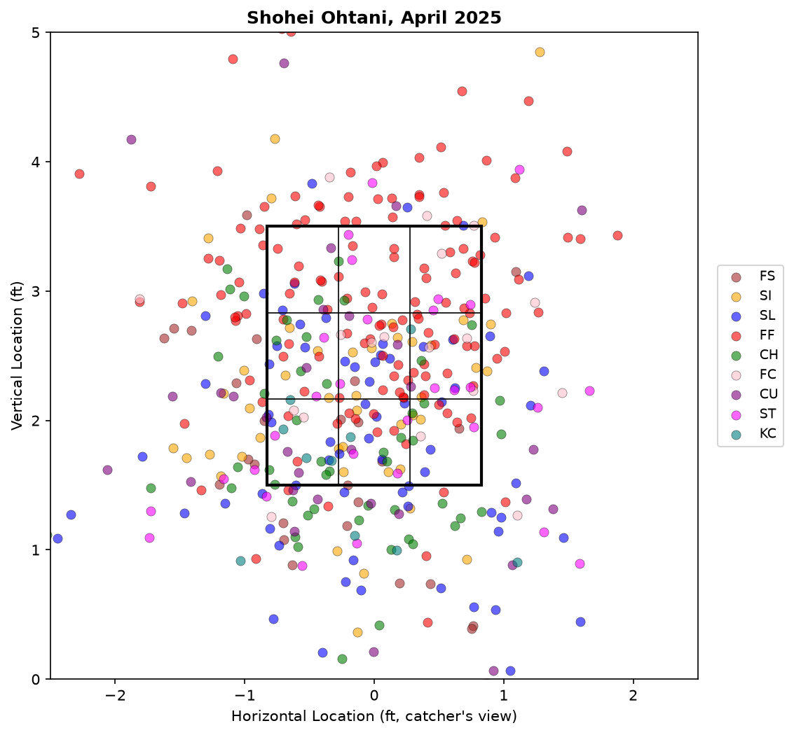
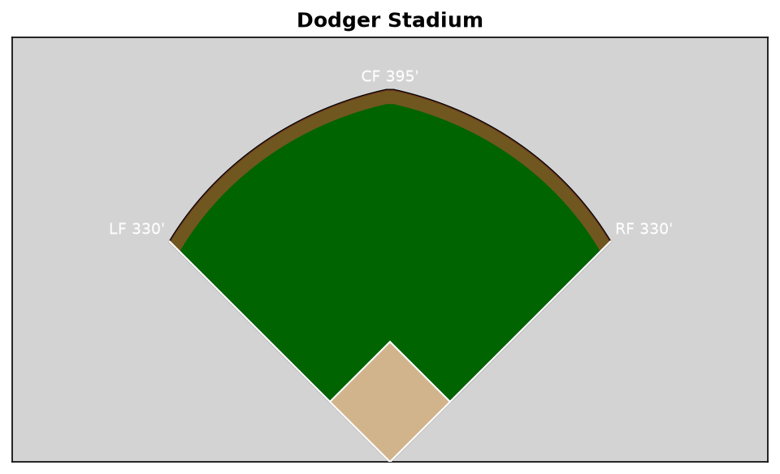

# bigleague

[](https://pypi.org/project/bigleague/)
[](https://pypi.org/project/bigleague/)
[](LICENSE)

bigleague is an async Python library for baseball data and plots. It fetches
Statcast pitches, Baseball Savant leaderboards, FanGraphs stats, and MLB
schedules and rosters. It uses [Polars](https://pola.rs) for tabular data and
Matplotlib for strike zones, hot zones, and spray charts.

```python
import asyncio
from datetime import date

import bigleague as bl


async def main() -> None:
    ohtani = await bl.resolve_id("Shohei", "Ohtani")  # MLBAM id
    df = await bl.statcast_batter(ohtani, date(2025, 4, 1), date(2025, 4, 30))
    print(bl.hot_cold_batter(df))  # {pa: 87, ab: 76, h: 22, avg: 0.289, ...}
    png = bl.strike_zone(df, "Shohei Ohtani, April 2025")


asyncio.run(main())
```

## Gallery

Each plot is a single call that returns PNG bytes. These use Shohei Ohtani's
2025 Statcast data; `uv run python -m docs.make_gallery` regenerates them.

| `strike_zone` | `hot_zones` |
| :---: | :---: |
|  |  |
| **`spray_chart`** | **`stadium_outline`** |
|  |  |

## Install

```bash
pip install bigleague
# or
uv add bigleague
```

Requires Python 3.12 or newer. The test suite runs on 3.12, 3.13 and 3.14.

Install `bigleague[bloom]` to add a Bloom filter that skips disk lookups for
keys that have never been cached.

## API

| Area | Functions | Source |
| --- | --- | --- |
| Pitch-level data | `statcast`, `statcast_batter`, `statcast_pitcher`, `statcast_season` | Baseball Savant |
| Savant leaderboards | `batter_percentile_ranks`, `pitcher_percentile_ranks`, `batter_pitch_arsenal`, `pitcher_pitch_arsenal`, `batter_exit_velo`, `pitcher_exit_velo`, `batter_expected_stats`, `pitcher_expected_stats`, `sprint_speed`, `pitcher_pitch_movement` | Baseball Savant |
| ABS challenges | `bl.abs.challenges`, `team_summary`, `team_top_challengers`, `player`, `league_leaders` | Baseball Savant |
| Season stats | `batting_stats`, `pitching_stats`, `fielding_stats`, `team_batting`, `team_pitching`, `*_range` variants, `player_stats`, `career_stats`, `top_leaderboard`, `playoff_odds` | FanGraphs |
| Schedules and rosters | `schedule`, `live_scores`, `next_game`, `recent_results`, `standings`, `roster`, `injuries`, `transactions` | MLB Stats API |
| Player lookup | `lookup`, `resolve_id`, `reverse_lookup`, `mlb_years` | Chadwick Bureau register |
| Plots | `strike_zone`, `batter_zone`, `matchup_zone`, `hot_zones`, `spray_chart`, `stadium_outline` | matplotlib |
| Stats helpers | `hot_cold_batter`, `hot_cold_pitcher`, `matchup_stats`, `hot_zones_grid`, `aggregate_career`, `season_range`, `parse_*` | computed locally |
| Stadiums | `normalize_stadium`, `stadium_metadata`, `stadium_team_code`, `known_stadiums` | bundled data |

Use `bl.mlb.players()` and `bl.mlb.players_multi_season()` for MLB player
lists. ABS challenge functions live in `bl.abs`.

## Examples

### Statcast

```python
# Player queries fetch one calendar year per request.
df = await bl.statcast_pitcher(543037, date(2025, 4, 1), date(2025, 9, 30))

# Team and league-wide queries fetch up to seven days per request.
week = await bl.statcast(date(2025, 4, 1), date(2025, 4, 7), team="NYY")

# Look up a player's MLBAM ID or Chadwick register row.
await bl.resolve_id("Gerrit", "Cole")  # -> 543037
await bl.lookup("Cole", "Gerrit")  # -> polars DataFrame of register rows
```

`StatcastPitch` defines the pitch fields. `STATCAST_SCHEMA` maps them to Polars
types.

### FanGraphs

```python
stats = await bl.player_stats("Shohei", "Ohtani", 2025)
leaders = await bl.top_leaderboard("WAR", 2025, n=10)
table = await bl.batting_stats(2024, 2025, qual=100)  # polars DataFrame

try:
    stats = await bl.player_stats("Gerrit", "Cole", 2025)
except bl.FangraphsBlockedError:
    pass  # transient Cloudflare block; retry later
```

### MLB Stats API

```python
games = await bl.live_scores("NYY")
game = await bl.next_game("NYY")
# game = {date, time, home_team, away_team, home_probable, away_probable}

season = await bl.schedule("NYY", 2025)
# One row per game in play order:
# {date, start_time, game_pk, is_home, opponent, status, score, record}
# status is "W", "L", "P" (postponed) or "S" (scheduled); record is the
# running "W-L" after that game.
last5 = [g for g in season if g["status"] in ("W", "L")][-5:]
```

Team arguments take standard abbreviations (`"NYY"`, `"LAD"`, ...) and raise
`ValueError` for anything unknown.

### Plots

Plot functions return PNG bytes. Use `Path.write_bytes()` to save a plot.

```python
from pathlib import Path

title = "Gerrit Cole, 2025"
png = bl.strike_zone(df, title)  # pitch locations, colored by pitch type
png = bl.batter_zone(df, title)
png = bl.matchup_zone(df, title)
png = bl.hot_zones(df, title)  # 3x3 batting-average heatmap by zone
png = bl.spray_chart(df, title, stadium_key="yankees")
png = bl.stadium_outline("yankees")

Path("stadium.png").write_bytes(png)
```

### Stadiums

```python
bl.normalize_stadium("Guardians")  # -> "indians"  (the Statcast key)
bl.normalize_stadium("Wizards")  # -> "generic"
bl.stadium_metadata("yankees")  # -> {"name": "Yankee Stadium", ...}
```

### ABS challenges

`bigleague.abs` wraps Baseball Savant's Automated Ball-Strike challenge
leaderboards (batter, pitcher and catcher roles, plus a team summary feed).

```python
row = await bl.abs.team_summary("NYY", 2025)
leaders = await bl.abs.league_leaders(2025, limit=10)
```

## Cache

| Aspect | Behavior |
| --- | --- |
| Backend | parquet on disk, optional bloom filter (`bloom` extra) |
| Location | `~/.bigleague/cache`; override with `BIGLEAGUE_CACHE_DIR=/path` |
| Disable | `BIGLEAGUE_NO_CACHE=1` |
| Fresh data | chunks where `end_date >= today` are never cached |
| Eviction | none; manage manually with `bl.cache.clear()` and `bl.cache.size()` |

A request that includes today always re-fetches until its chunk ages into the
past. To force fresh data for a backfill, set `BIGLEAGUE_NO_CACHE=1` for that
run. The player register from the Chadwick Bureau is cached in the same
directory.

## Benchmarks

Each library ran in a separate process and queried Baseball Savant for Shohei
Ohtani (660271). In the warm run, bigleague read from its Parquet cache.
pybaseball and pandas+pyarrow each fetched the data again.

| lib            | scenario   |  rows |  frame |  peak heap |  peak RSS |  wall |
| -------------- | ---------- | ----: | -----: | ---------: | --------: | ----: |
| bigleague      | month cold |   426 | 194 KB |      52 MB |    161 MB | 1.35s |
| pybaseball     | month cold |   426 | 433 KB |      85 MB |    260 MB | 2.69s |
| pandas+pyarrow | month cold |   426 | 375 KB |      48 MB |    167 MB | 1.27s |
| bigleague      | month warm |   426 | 193 KB |      48 MB |    151 MB | 1.20s |
| pybaseball     | month warm |   426 | 433 KB |      85 MB |    260 MB | 2.60s |
| pandas+pyarrow | month warm |   426 | 375 KB |      48 MB |    166 MB | 1.27s |
| bigleague      | season     |  2859 | 1.3 MB |      55 MB |    168 MB | 1.40s |
| pybaseball     | season     |  2850 | 2.8 MB |      96 MB |    281 MB | 2.71s |
| pandas+pyarrow | season     |  2859 | 2.5 MB |      51 MB |    176 MB | 1.29s |
| bigleague      | hotzones   |   426 | 193 KB |      48 MB |    158 MB | 1.23s |
| pybaseball     | hotzones   |   426 | 433 KB |      99 MB |    290 MB | 2.93s |
| pandas+pyarrow | hotzones   |   426 | 375 KB |      80 MB |    250 MB | 2.21s |

The benchmark requires network access.

```bash
uv pip install pybaseball pandas pyarrow
uv run python bench/compare_pybaseball.py
```

## Data sources

bigleague is an independent project. It is not affiliated with or endorsed by
Major League Baseball, Baseball Savant, FanGraphs or the Chadwick Bureau.

- **Baseball Savant** CSV endpoints. bigleague runs up to five Savant requests
  concurrently.
- **FanGraphs** JSON endpoints. Requests blocked by Cloudflare raise
  `FangraphsBlockedError`.
- **MLB Stats API** (`statsapi.mlb.com`).
- **Chadwick Bureau register** for player ids, fetched from a pinned commit.

Check each provider's terms before using the data commercially. Keep the
cache enabled to avoid repeat requests.

## Development

```bash
git clone https://github.com/klobucar/bigleague
cd bigleague
uv sync --extra dev                  # add `--extra bloom` to test the bloom path
uv run pytest
uv run ruff check . && uv run ruff format --check .
uv run ty check
```

The tests mock HTTP requests and disable the cache. To record a live response
with `pytest-recording`, run the Savant tests in record mode.

```bash
uv run pytest tests/test_savant.py --record-mode=once
```

### Layout

```
bigleague/
├── models.py     # StatcastPitch dataclass, the schema source of truth
├── schema.py     # polars dtype map derived from models
├── http.py       # shared async client, semaphore, retries
├── cache.py      # parquet cache, optional bloom filter
├── stadiums.py   # stadium data and name normalization
├── stats.py      # pure polars computation, no I/O
├── players.py    # Chadwick Bureau lookup
├── mlb.py        # MLB Stats API
├── savant.py     # Baseball Savant: pitch chunks and leaderboards
├── abs.py        # Baseball Savant: ABS challenge leaderboards
├── fangraphs.py  # FanGraphs JSON API (curl_cffi)
└── plots.py      # matplotlib renderers
```

## Used by

[harry-bot](https://github.com/klobucar/harry-bot), a Discord baseball bot.

## License

[MIT](LICENSE)
