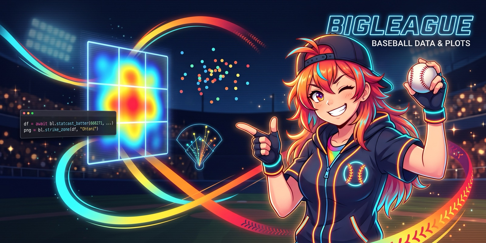
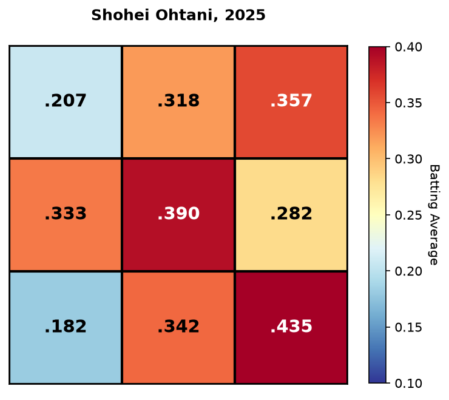
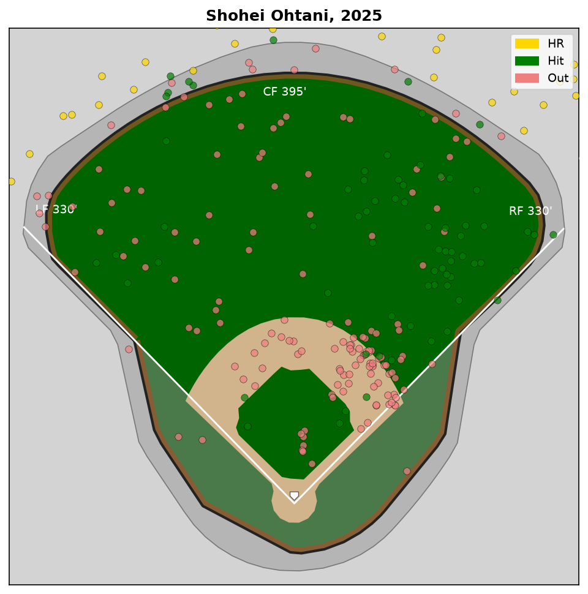

<p align="center">
  
</p>

# bigleague

[](https://pypi.org/project/bigleague/)
[](https://pypi.org/project/bigleague/)
[](LICENSE)

Fetch Statcast pitches, Baseball Savant leaderboards, FanGraphs stats, and MLB
schedules and rosters from Python. Requests use `asyncio`, tabular results use
[Polars](https://pola.rs), and plots are returned as PNG bytes.

## Quick start

Install with `pip install bigleague` or `uv add bigleague`. Requires Python 3.12+.

This saves a strike-zone plot of the pitches Shohei Ohtani saw in April 2025.

```python
import asyncio
from datetime import date
from pathlib import Path

import bigleague as bl


async def main() -> None:
    ohtani = 660271  # MLBAM ID
    pitches = await bl.statcast_batter(ohtani, date(2025, 4, 1), date(2025, 4, 30))
    png = bl.strike_zone(pitches, "Shohei Ohtani, April 2025")
    Path("ohtani-april.png").write_bytes(png)


asyncio.run(main())
```

## Gallery

| `strike_zone` | `hot_zones` |
| :---: | :---: |
|  |  |
| `spray_chart` | `stadium_outline` |
|  |  |

The strike-zone plot covers April 2025. The hot zones and spray chart use
Ohtani's season data. Passing `stadium_key="dodgers"` to `spray_chart` selects
batted balls at Dodger Stadium.

## Fetching data

### Statcast

```python
ohtani = await bl.resolve_id("Shohei", "Ohtani")  # 660271
if ohtani is not None:
    pitches = await bl.statcast_season(ohtani, 2025, "batter")
    print(bl.hot_cold_batter(pitches))

yankees = await bl.statcast(date(2025, 4, 1), date(2025, 4, 7), team="NYY")
```

`resolve_id` looks up an MLBAM ID in the Chadwick Bureau register. Use
`lookup("Ohtani", "Shohei")` for the register rows.

`statcast_batter` and `statcast_pitcher` take a date range. `statcast` takes
an optional team and splits the range into requests of up to seven days.
bigleague allows up to five concurrent Savant requests. See
`STATCAST_SCHEMA` for the pitch columns and their Polars types.

Savant leaderboards include sprint speed, expected stats, pitch arsenals,
and pitch movement. Automated Ball-Strike challenge data is available under
`bl.abs`.

```python
speed = await bl.sprint_speed(2025)
challenges = await bl.abs.team_summary("NYY", 2025)
```

### FanGraphs

```python
ohtani = await bl.player_stats("Shohei", "Ohtani", 2025)
war_leaders = await bl.top_leaderboard("WAR", 2025, n=10)
batting = await bl.batting_stats(2024, 2025, qual=100)
```

`batting_stats`, `pitching_stats`, and `fielding_stats` return Polars
DataFrames. If Cloudflare blocks a request, bigleague raises
`FangraphsBlockedError`.

### MLB Stats API

```python
season = await bl.schedule("NYY", 2025)
last_five = [game for game in season if game["status"] in {"W", "L"}][-5:]
for game in last_five:
    print(game["date"], game["opponent"], game["score"], game["record"])
```

`schedule` defaults to the regular season. It returns games in play order
with the team's running win-loss record. Status is `W` or `L` for final
games, `P` for postponed or suspended games, and `S` for scheduled games.

Use team abbreviations such as `NYY` or `LAD` with `live_scores`,
`next_game`, `recent_results`, `roster`, `injuries`, and `transactions`.
Use `standings(year)` for division standings. Player lists are available
through `bl.mlb.players` and
`bl.mlb.players_multi_season`.

## Cache

Historical Statcast data is cached as Parquet under `~/.bigleague/cache`.
Chunks ending today or later are fetched each time. The Chadwick player
register uses the same directory.

Set `BIGLEAGUE_CACHE_DIR` to move the cache or `BIGLEAGUE_NO_CACHE=1` to skip
cache reads and writes for a run. Statcast entries stay on disk until you
remove them. Use `bl.cache.size()` to check their size and `bl.cache.clear()`
to remove them.

The optional `bigleague[bloom]` extra skips disk lookups for keys the cache
doesn't contain.

## Benchmarks

These runs use Ohtani's 2025 Statcast data. The month is April, and the season
run covers April through September. Each library ran in its own process.
For the warm run, bigleague read from its Parquet cache while the other two
fetched the data again. The `hotzones` run calculates batting average by zone.

| lib            | scenario   |  rows |  frame |  peak heap |  peak RSS |  wall |
| -------------- | ---------- | ----: | -----: | ---------: | --------: | ----: |
| bigleague      | month cold |   426 | 194 KB |      52 MB |    161 MB | 1.35s |
| pybaseball     | month cold |   426 | 433 KB |      85 MB |    260 MB | 2.69s |
| pandas+pyarrow | month cold |   426 | 375 KB |      48 MB |    167 MB | 1.27s |
| bigleague      | month warm |   426 | 193 KB |      48 MB |    151 MB | 1.20s |
| pybaseball     | month warm |   426 | 433 KB |      85 MB |    260 MB | 2.60s |
| pandas+pyarrow | month warm |   426 | 375 KB |      48 MB |    166 MB | 1.27s |
| bigleague      | season     |  2859 | 1.3 MB |      55 MB |    168 MB | 1.40s |
| pybaseball     | season     |  2850 | 2.8 MB |      96 MB |    281 MB | 2.71s |
| pandas+pyarrow | season     |  2859 | 2.5 MB |      51 MB |    176 MB | 1.29s |
| bigleague      | hotzones   |   426 | 193 KB |      48 MB |    158 MB | 1.23s |
| pybaseball     | hotzones   |   426 | 433 KB |      99 MB |    290 MB | 2.93s |
| pandas+pyarrow | hotzones   |   426 | 375 KB |      80 MB |    250 MB | 2.21s |

The benchmark requires network access.

```bash
uv pip install pybaseball pandas pyarrow
uv run python bench/compare_pybaseball.py
```

## Development

```bash
git clone https://github.com/klobucar/bigleague
cd bigleague
uv sync --extra dev
uv run pytest
uv run ruff check . && uv run ruff format --check .
uv run ty check
```

The tests mock HTTP requests. Add `--extra bloom` to `uv sync` to run the
Bloom filter tests.

Regenerate the gallery from the repository root with
`uv run python -m docs.make_gallery`. It fetches data from Baseball Savant
and writes the PNGs to `docs/img/`.

## Used by

[harry-bot](https://github.com/klobucar/harry-bot), a Discord baseball bot.

## License

[MIT](LICENSE). bigleague is an independent project. Check the data
providers' terms before commercial use.
